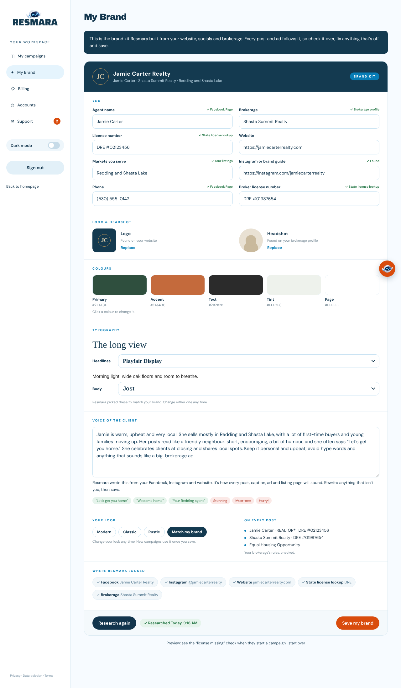

# Engine 2 brain: Brand

**Status:** written and greenlit with Adam, sent to Dan 22 Nov · **Builds in:** PR #22 · **Started:** 22 Nov 2026
**Detailed spec (14 Nov):** the Brand Engine spec v1.0 in the Resmara Buildout project (the proven Boost prompts
are in its Appendix B and are the starting point for the AI steps below)

**Scope (Adam, 22 Nov):** this engine only researches the agent and builds their brand page. It is
baked into the new client sign-up (Engine 1): it runs in the background during sign-up and is done
by the time they reach the finish pop-up. The sign-up itself is Engine 1, which ends at **Show me
around**; the tour and any fixes after that are the **Resmara sign-up tour engine**.

## 1. Job (Adam, 22 Nov)

**Act like a private investigator hired to learn everything about this agent's real estate
career**, then turn what it finds into their brand kit.

1. **Investigate.** An AI quickly looks them up: their Facebook Page, their Instagram,
   their website, a Google search on them, then anything else it finds (YouTube, Zillow,
   Realtor.com, their brokerage's site, the state license lookup).
2. **Build the brand kit** from what it found: logo, names, license numbers, phones, brokerage,
   colours, fonts, a look and a brand voice that fit *them*.
3. **Put it on My Brand**, finished, as part of sign-up. The agent adjusts anything they don't
   like, any time.

**Quick, and part of sign-up.** It starts the moment they sign in with Facebook and runs in the
background while the robot works through the sign-up checks. A few minutes at most.

Every later engine (posts, ad, website, reports) builds from this kit.

**Principles**

- **Discovery, not a template.** It should feel like someone really looked into them, never
  cookie cutter.
- **As accurate as it can be.** Every fact has a source. Facts that go on posts are never guessed.
- **Their persona shapes the voice; their private life never goes in the kit** (section 5).
- **No brand form.** The agent is never asked to fill this in; it's done for them.

## 2. The investigation (AI-led)

Unlike Engine 1, where rules decide everything, this engine **needs AI to do the work**: look
around, follow leads, compare what it finds, and come back with a judgement.

**Where it looks, in this order**

| # | Source | What it's looking for |
|---|--------|-----------------------|
| 1 | Their Facebook Page | Name as they use it, About, category, phone, website, address, profile photo and cover, recent posts and how they write |
| 2 | Their Instagram | Bio, the last 30 posts (the images themselves and the captions), how often they post, what they post about |
| 3 | Their website | Logo files, colours and fonts in the code, footer wording (phone, license, brokerage), how they describe themselves |
| 4 | A Google search on them | Other profiles, press, team pages, reviews, the areas they serve |
| 5 | Everything else it finds | YouTube, LinkedIn, Zillow, Realtor.com, Homes.com, Google Business Profile |
| 6 | Their brokerage | The local office's exact name, logo lockup, broker license number, published brand rules |
| 7 | The state license lookup | Their license number and status, and the broker of record |

**Agents with only a personal Facebook and Instagram (most of them)**

Meta doesn't let apps read a personal profile's posts or a personal Instagram. For these agents
the investigation can't study their feed at first. It builds from what's public instead: their
website, their brokerage's brand, Google, Zillow and Realtor.com, and the license lookup. They
still get a real brand kit on day one. Once their business Page and Instagram are connected,
Resmara reruns the investigation and the kit gets sharper.

**What it works out**

- **Identity:** name as it should print, title, phone, email, license number, the brokerage and
  the broker's license number, office address, areas they serve.
- **Personality profile:** what kind of person they are and what it's like to work with them.
  Polished or casual, warm or straight to the point, funny, luxury, community-focused, what
  they're proud of. If they've given access to a personal profile too, it can be read lightly to
  get a sense of who they are (never mined, never quoted).
- **Posting habits:** how much they post (a lot, a little, rarely), what about (listings, sold,
  market updates, community, behind the scenes, themselves), and what gets the most response.
- **Their look:** whether they have their own logo or only the brokerage's, and the colours,
  lettering and photo style from the brand they already use (see "Colours and look" below).
- **Their voice:** tone, phrases and hashtags they repeat, how they sign off, emoji habits.
- **The brokerage's rules:** required marks, co-branding rules, the local office's exact name.

**Making sure it's really them: the license number and photo**

Agents share names, so the investigation fixes two reference points first, then checks everything
else against them:

1. **Their license number.** Found on their Facebook Page, Instagram or website (agents are
   required to show it), then confirmed in the state license lookup, which also gives the
   brokerage of record.
2. **Their photo.** Their profile photo or headshot.

Anything found after that only counts if it matches the license number, the photo, or is linked
from their own pages. If it doesn't match, it's ignored. Information about another agent must
never end up in this agent's brand.

**Colours and look: take them from the brand they already use**

The agent has already approved a look somewhere, so Resmara uses it rather than inventing one.
In this order:

1. **Their own real estate website**, if they have one: colours, fonts and logo from its code.
2. **Their own designed graphics and logo** on Facebook and Instagram.
3. **Their brokerage's brand**, if they don't have their own look: the local office's colours,
   fonts and logo lockup, within its brand rules.

Only if none of these exist does the AI choose a look that fits their personality and market, and
it marks it as chosen so they can change it.

**How it works (the AI steps)**

1. **Gather:** read their Facebook Page and Instagram with their own Meta connection from
   Engine 1 (the audit already has the Page, website and phone).
2. **Look at their posts:** a vision AI studies their recent images and captions (the Boost
   "social audit").
3. **Investigate:** an AI with web search follows the leads: their site, Google, other profiles,
   the brokerage, the license lookup. It keeps going until it has the identity facts confirmed
   or has run out of places to look, within a time and cost limit.
4. **Build the brand kit** from what it found, write the **Voice of the client**, and save both
   to My Brand.

Speed: quick and brief, a few minutes at most, finished inside sign-up (section 3a).

## 3. No separate case file

The investigation's notes are working notes. What's worth keeping goes into the brand kit itself,
and the rest is dropped once the kit is saved:

- the facts, each with where it was found and how sure it is (confirmed, found once, not found);
- the **Voice of the client** write-up (section 4), which the Campaign build engine uses for every
  post, ad and listing page;
- what to avoid for them.

Nobody needs to read a case file. The brand kit on My Brand is the one record, and it's always
the current one: whatever the agent changes (fonts, colours, voice, tone) is what every campaign
uses next.

## 3a. Where it fits in sign-up

It starts the moment they sign in with Facebook (Engine 1) and runs alongside the Facebook checks
on the sign-up pop-up ("Looking at your posts", "Researching you and your brokerage", "Building
your brand kit"). The finish pop-up shows the brand it built. If anything essential is missing
(like the license number), it's logged on My Brand for the sign-up tour to point out.

## 4. The brand kit (what lands on My Brand)

- **You:** name, title, phone, email, website, license number, brokerage, broker license number,
  areas served. Each shows where it was found.
- **Logo and headshot:** their own logo first, every version found, then the brokerage lockup.
- **Colours:** their palette as editable swatches.
- **Fonts:** a headline font and a body font (real Google Fonts) chosen to fit them.
- **Look:** always set to **Match my brand** by the build. Modern, Classic and Rustic stay as
  choices on My Brand; each will get its own design guidelines in the Campaign build engine.
- **Voice of the client:** a short write-up the AI writes from its research, for the other
  engines to read (see below). Plus phrases to use and avoid, and their sign-off.
- **On every post:** the legal closing line (name, phone, license, brokerage, Equal Housing).
- **Where Resmara looked:** the sources.

**Voice of the client**

The most important thing the investigation writes. A short paragraph (about 80 to 120 words) in
plain words, describing the agent the way a colleague would brief a copywriter:

- their personality and how they come across (warm, direct, playful, polished);
- what it's like to work with them, and what they bring to clients;
- the community and areas they work, and their primary reach (first-time buyers, luxury,
  relocation, a particular town);
- how they talk online: phrases they use, how they sign off, emoji or not;
- anything to stay away from.

Example: *"Jamie is warm, upbeat and very local. She grew up in Redding and sells mostly in
Redding and Shasta Lake, with a lot of first-time buyers and young families moving up. Her posts
read like a friendly neighbour: short, encouraging, a bit of humour, and she often says 'Let's
get you home.' She celebrates clients at closing and shares local spots. Keep it personal and
upbeat; avoid hype words and anything that sounds like a big-brokerage ad."*

- It sits on **My Brand** under **Voice of the client**, as an editable text box. The agent can
  rewrite it any time.
- The **Campaign build engine reads it every time** it writes posts, captions, the ad and the
  listing website, so whatever is in that box (as the agent last saved it) is what shapes the
  words.
- Persona only: it never mentions anything personal (family, health, religion, politics).

**Positive only (guardrail)**

The voice is built from the best of how they work with clients, never from the worst of what they
post. The investigation **skips** anything negative and never lets it shape the tone:

- politics, complaints about the government, rants, arguments with commenters;
- anything angry, mocking, divisive or sarcastic at someone's expense;
- innuendo or wording that could read as offensive or exclusionary.

It looks only for the positive: how they help people, what they're proud of, how they celebrate
clients and their community. If most of what they post is negative or political, the voice is
built from their professional pages and listings alone, kept warm and neutral, and nothing from
those posts is quoted or echoed.

The Campaign build engine applies the same rule when it writes: every post, caption and ad is
positive and professional, never political, divisive or negative, whatever the Voice of the
client box says.

The agent can change anything. Their changes always win, except over brokerage and legal rules,
and survive Research again. Changing the font on a single post is done on that post (Campaign
engine), not here.

## 5. Accuracy guardrails

- **Facts that print on posts are never guessed:** phone, license numbers, brokerage name, legal
  line. Each needs a source; the license number comes from the state lookup. Missing stays
  missing: the empty field is highlighted on My Brand, and the Campaign build engine checks for
  it before building (section 6a).
- **Style can be a judgement** (colours, fonts, voice, look), but anything chosen rather than
  found is marked so the agent can confirm it.
- **Local office, never the national mark alone** ("Shasta Sotheby's International Realty").
- **Their own logo leads.** A brokerage logo never stands in for it.
- **Real Google Fonts only.**
- **Positive only.** Negative, political or divisive content is skipped and never shapes the
  voice or appears on a post (section 4).
- **Persona, not personal information.** Their personality can shape the voice ("what it's like
  to work with me"), but nothing personal goes in the kit or on a post: no health, religion,
  politics, family members, children, home life, even if it's public or on a personal profile
  they gave access to.
- **Make sure it's them:** everything is checked against their license number and photo
  (section 2).

## 6. Keeping it current

- The brand kit just lives on My Brand once it's built. The agent changes it whenever they like.
- **Research again** reruns the investigation (for example after changing brokerage, which can
  bring new rules). Their own changes survive. How a rerun handles a new brokerage or license is
  for later; for now it's a button that rebuilds.
- No automatic refresh.

## 6a. Missing phone, license or brokerage (Campaign build engine)

The kit never holds up sign-up. The check happens when it matters: when they start a campaign.

1. They click **+ Campaign**.
2. Resmara checks the kit has a phone number, license number and brokerage.
3. If any is missing, Resmara asks for just that, right in the campaign flow: *"Your license
   number is missing. It has to go on every post."* with a box to type it in. Saving it puts it on
   My Brand too, so they're never asked again.

(Logged on the Campaign build engine, Engine 4.)

## 7. What's wrong today

- The onboarding step "Building your brand" is an animation; nothing is built.
- The server can only read the Facebook Page and suggest a palette. No Instagram study, no web
  investigation, no license lookup.
- Nothing is saved automatically, and it reads the Meta login from the ad account record (the
  Engine 1 bug, fixed in PR #18).
- My Brand (font picker, look, Research again, save before leaving) is built in PR #17.

## 8. Decided with Adam (22 Nov 2026)

- Colours and look come from the brand they already use: their own website, then their own
  graphics, then their brokerage's brand.
- Their license number and photo are the reference points for "is this really them".
- Persona can shape the voice; nothing personal goes in the kit.
- Quick, and baked into the new client sign-up (Engine 1). The sign-up, its finish pop-up and the
  tour are not part of this engine.
- Missing phone, license or brokerage is checked when they start a campaign and asked for right
  there.
- No separate case file; what matters lives in the brand kit.
- No automatic refresh; Research again only, worked out later.
- The investigation writes a **Voice of the client** paragraph on My Brand, editable, read by the
  Campaign build engine for everything it writes.
- The voice is **positive only**: negative, political or divisive content is skipped, and posts
  are always positive and professional.
- **Your look** keeps all four choices and defaults to **Match my brand**. The guidelines for
  Modern, Classic and Rustic are written with the Campaign build engine, not here.
- Most agents start with a personal Facebook and Instagram, so the first kit often comes from
  public sources and gets sharper once their Page and business Instagram are connected.

---

## Screens (what it should look like)

1. **My Brand, as the brand engine fills it in:** phone and broker license number in You, with
   where each was found, and the Voice of the client section.
   
