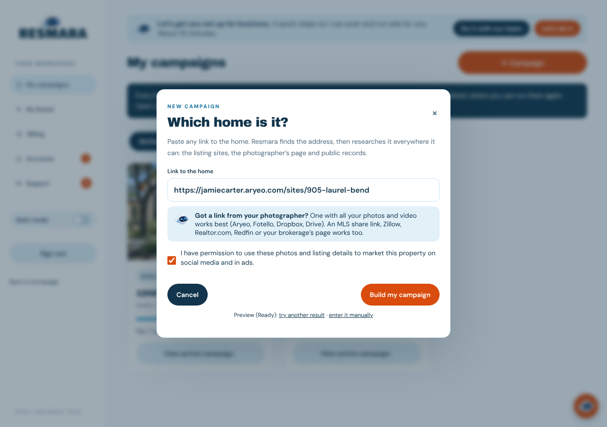
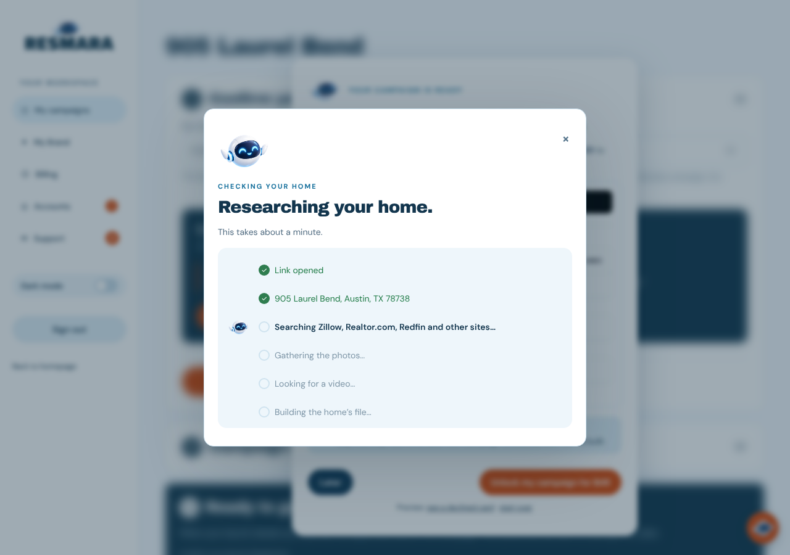
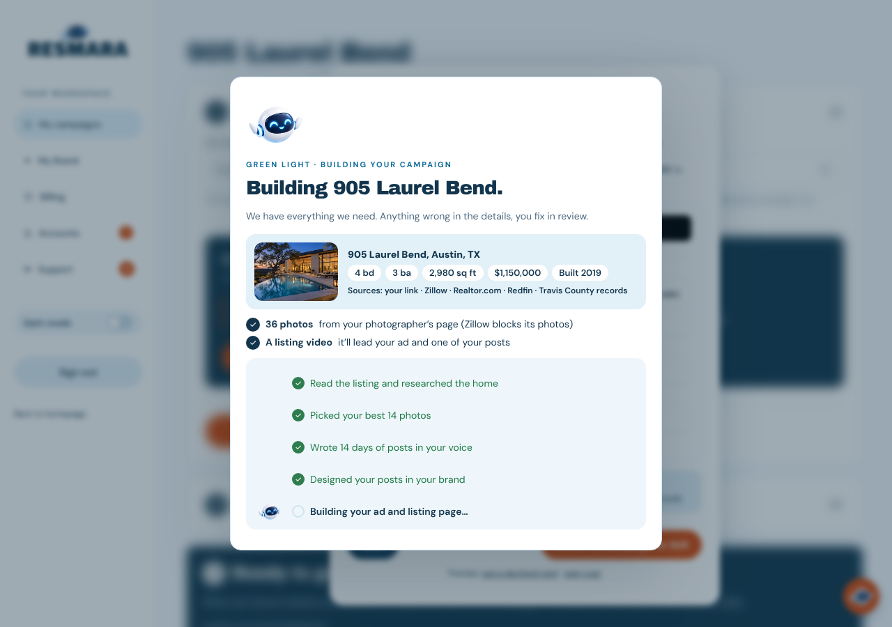
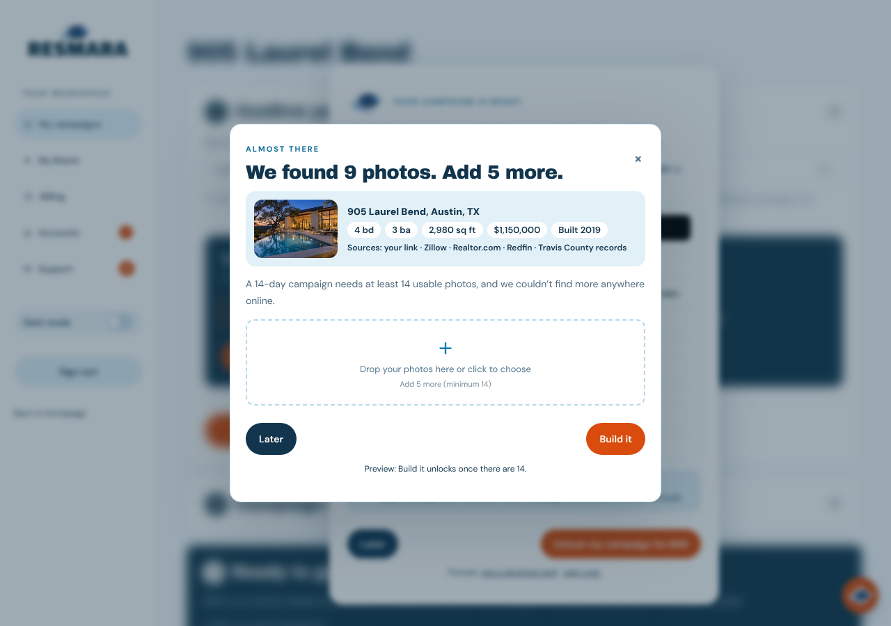
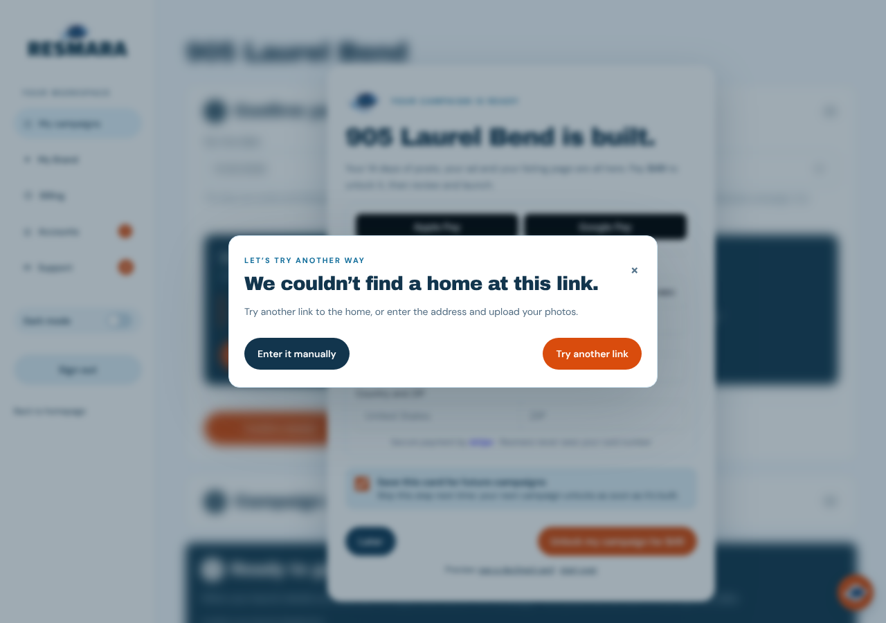
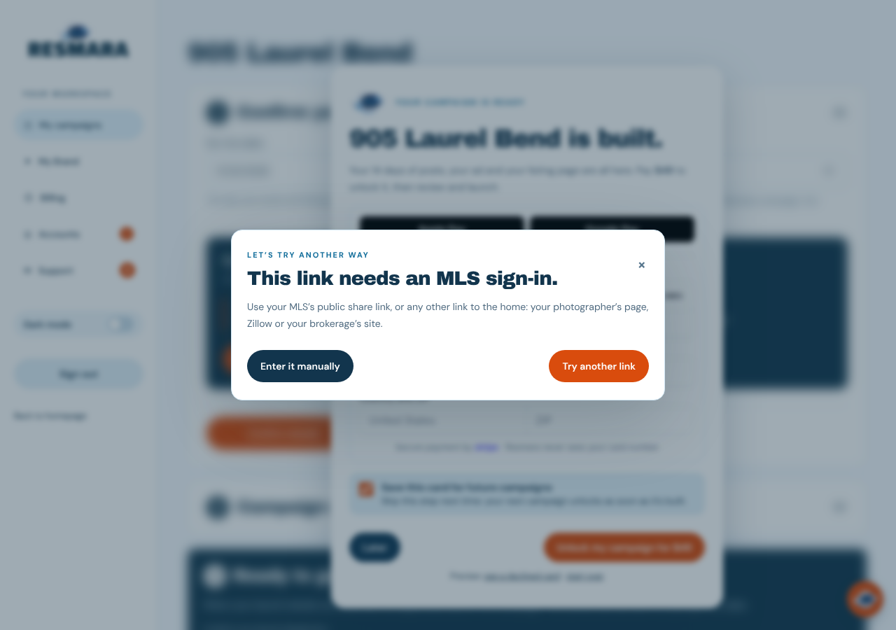
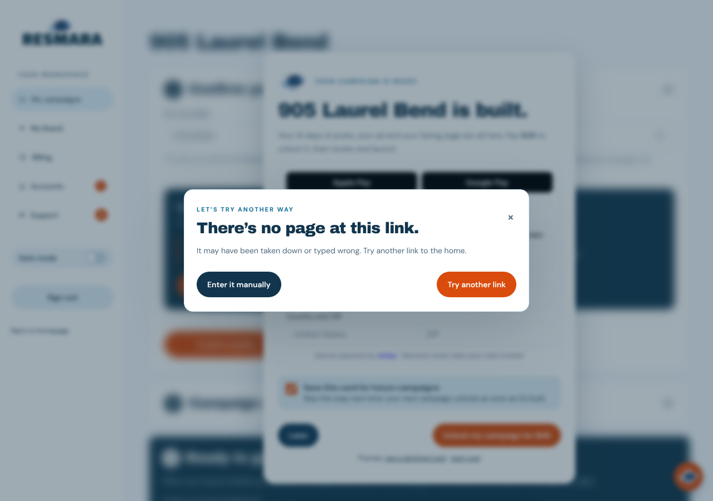
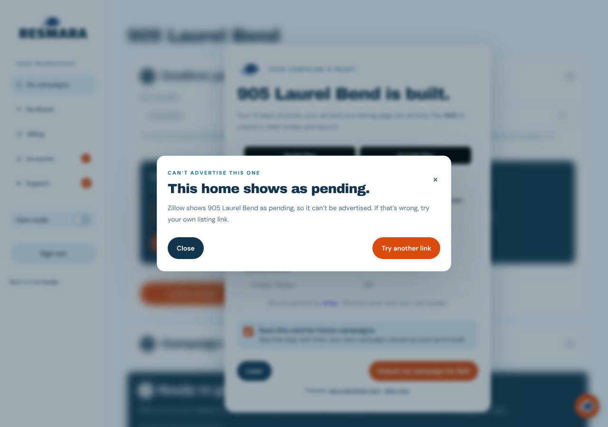
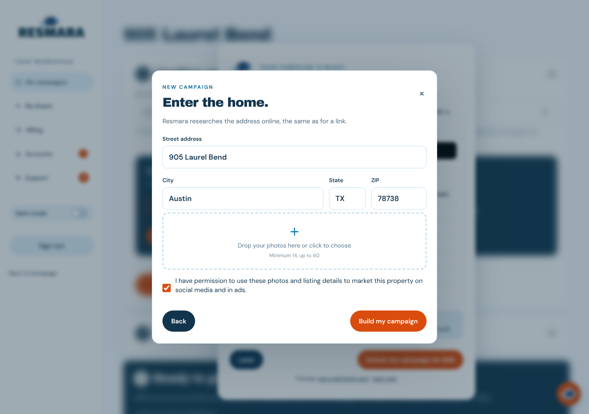
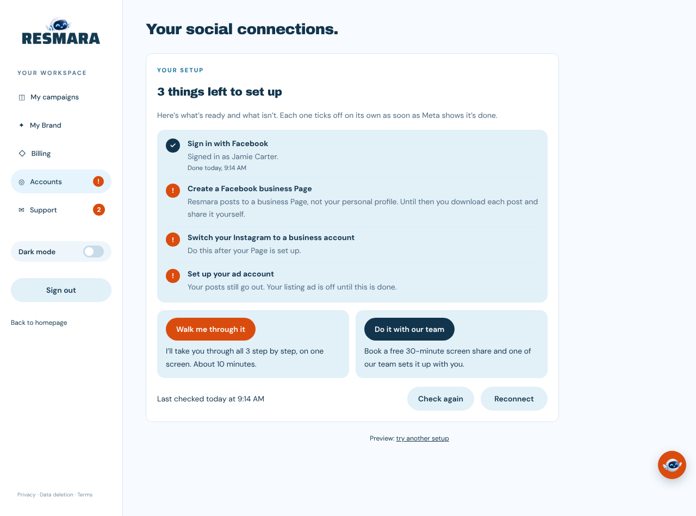

# Engine 3 brain: Listing link

**Status:** written and greenlit with Adam, sent to Dan 22 Nov · **Builds in:** PR #24 · **Started:** 22 Nov 2026
**What exists today:** `listing-link-engine.md` (the 21 Nov build spec). This brain replaces its pay-before-build and other-agent parts.
**Clickable mockup:** `engine-3-screens/mockup.js` (preview only, not for deploy)

---

## 1. Job

Turn whatever link the agent pastes into **the home's file**: everything Resmara can learn about
the house, from every source it can reach, with where each fact came from. Every engine after this
one reads from that file: the campaign build (posts, design, ad), the listing website, publishing,
and Run it until it sells.

**Starts:** the agent pastes a link on **+ Campaign** (or enters the address and uploads photos).
**Ends:** the home's file has an address, at least 14 usable photos and the video if there is one,
and the campaign build starts.

**It's the gate for the build.** The build now runs before the agent pays (pay to unlock, Engine 4),
so Resmara pays the AI cost of every build. Nothing is built unless this engine is sure there's a
real home, an address and enough photos.

## 2. The link is a reference, not the source (Adam, 22 Nov)

The agent can paste **any link they think represents the home well**: an MLS share link, Zillow,
Realtor.com, Redfin, their brokerage site, their photographer's delivery page (Aryeo, Fotello), a
Dropbox or Drive folder. The link's job is to tell Resmara **which house** this is.

From there, the AI builds **a dossier on the house from every source it can reach**:

- the pasted link itself (details, photos, video);
- the same home on the popular listing sites (Zillow, Realtor.com, Redfin, Homes.com, Trulia) and
  the brokerage's own site;
- the photographer's delivery page, if one turns up;
- public records for the address;
- **later (phase 2):** MLS and IDX data. Each MLS requires a data agreement (broker, vendor and the
  MLS) before an app can read its feed, so this comes after launch, MLS by MLS.

**The form nudges them toward the best link:** "Any link to the home works. Got a link from your
photographer with all your photos and video? That one works best."

**Photos come from whichever source gives the best set:** full-size, the most photos, no
watermarks. A portal that blocks its photos doesn't stop the campaign if another source has them.

## 3. What the agent sees

1. **+ Campaign:** the link box (with the photographer hint) and the photo permission tick.
   Button: **Build my campaign** (no price: they pay after the build).
2. **A live checklist** while it researches:
   - Opening your link
   - Finding the home's address
   - Searching Zillow, Realtor.com, Redfin and other sites
   - Gathering the photos
   - Looking for a video
   - Building the home's file
3. **The result**, one of:

| Result | When | Agent sees | Next |
|--------|------|------------|------|
| **Ready** | Address, 14+ usable photos | Goes straight into the build, no extra click: "Green light · Building 905 Laurel Bend. We have everything we need. Anything wrong in the details, you fix in review." with the home's photo, the facts (4 bd · 3 ba · 2,980 sq ft · $1,150,000), their sources, the photo count and source, and the video | Build, then pay to unlock |
| **Too few photos** | Address, fewer than 14 usable photos from every source | "We found 9 photos. A 14-day campaign needs at least 14. Add 5 more." with the upload box | Build once there are 14 |
| **No home found** | Nothing at the link points to a home, and no address | "We couldn't find a home at this link. Try another link, or enter the address and upload your photos." | Another link, or the manual path |
| **Sign-in link** | An MLS link that needs a log-in | "This link needs an MLS sign-in. Use your MLS's public share link, or any other link to the home." | Another link |
| **Dead link** | The page is gone | "There's no page at this link. It may have been taken down or typed wrong." | Another link, or manual |
| **Sold or pending** | Any source says so | "This home shows as sold/pending, so it can't be advertised." | Stop |
| **Not a link** | Not a web address | "That doesn't look like a complete web link." | Fix it |

**The manual path:** the address, at least 14 photos (up to 60) and the permission tick. The
dossier research then runs on the address, the same as for a link.

**Not checked (Adam, 22 Nov):** whether the listing belongs to someone else. No agent pays to
promote another agent's listing, so there's no "different listing agent" outcome.

## 4. Facts: found, sourced, never invented

- **Every fact carries its source** (the link, Zillow, public records…) and the exact words it came
  from. No source, no fact: that's checked in code, not trusted to the AI.
- **When sources disagree** (say, square footage), the listing's own page wins, then the MLS-fed
  portals, then public records. The others are kept as notes.
- **No confirm step before the build** (Adam, 22 Nov). The agent fixes anything wrong **in review**.
  Facts found only by research (not on a listing page) are marked "found online, please check" in
  review, and the post writer never states them as fact until the agent leaves them in.

## 5. Photos and video

- **At least 14 usable photos** to build (no reusing photos to stretch a short set). Up to 60 are
  gathered.
- **Every photo is scored** by vision AI (built): room, a social score, post yes or no.
- **Only the photos actually used are copied into Resmara.** The rest are kept as links for 30
  days, so a swap in review can offer "other photos of this home".
- **The listing video is always used when there is one** (Adam, 22 Nov): it gets more reach than
  any other format. It becomes the ad and one of the posts.

## 6. What the AI does

| Job | Given | Must return | Guardrail |
|-----|-------|-------------|-----------|
| Find the house | The link and its page | The address (and listing details on the page) | Address must appear on the page or in the link |
| Search other sources | The address | The same home on other sites, the photographer's page, public records | Must match the address; a different unit or lot is dropped |
| Read each source | Each page's text | Facts with the exact words they came from | No quote, no fact (checked in code) |
| Score photos | Each photo | Room, score, post yes or no | Built; "no" photos are never used |

## 7. The home's file (what it hands over)

Stored on the campaign. Address, price, beds, baths, square footage, lot, year built, type,
description, features, status (active, pending, sold), open houses, photos (with source), video,
every fact's source and quote, which facts need checking, the link and when it was checked.
Engines 4–8 read the home only from here.

## 8. How we'll know it works

- A corpus of 30 real links (MLS share links from 5+ MLSs, Zillow, Realtor.com, Redfin, Homes.com,
  a brokerage site, Aryeo, Fotello, Dropbox, Drive, a sold, a pending, a dead link, a sign-in link)
  each gets the right result. Run on every change and nightly: portals change without warning.
- A Zillow link whose photos are blocked still ends Ready when another source has the photos.
- Every fact in the file has a source and a quote that appears on that source.
- Nothing builds without an address and 14 photos.

## 9a. Also in this PR: one box on Accounts (Adam, 22 Nov)

Not part of the listing link, but it ships with this PR. **Accounts → Your setup** shows **one
box**: the heading ("3 things left to set up"), every item in a single list (ticked when done, an
orange mark when not, one line on what it means), and then **one pair of buttons** for all of
them, each with a line on what it does:

- **Walk me through it:** "I'll take you through all 3 step by step, on one screen. About 10
  minutes." Opens the setup plan (the sign-up tour engine's one pop-up for the Page, Instagram and
  ad account).
- **Do it with our team:** "Book a free 30-minute screen share and one of our team sets it up with
  you." Opens the Resmara setup session booking.

No more separate Walk me through it / Do it with our team buttons on each item. Check again and
Reconnect stay at the bottom. This replaces Engine 1's per-item setup to-do list layout (the list
and how items tick off stay the same).

## 9. Decided with Adam (22 Nov 2026)

- Any link works; it identifies the house. The AI then researches every source it can reach.
- The form encourages the photographer's link first.
- MLS and IDX feeds: phase 2 (each MLS needs a data agreement).
- Fewer than 14 photos: ask for more, as today.
- No check for someone else's listing.
- No confirm step before the build; facts are fixed in review.
- The listing video is always used.
- The button is **Build my campaign** with no price (pay to unlock after the build).
- Accounts shows one setup box with one Walk me through it and one Do it with our team (9a).

## Screens

From the clickable mockup Adam reviewed on 22 Nov.

1. **+ Campaign: which home is it?** (any link; the photographer tip)
   
2. **Researching the home**
   
3. **Green light, straight into the build** (Zillow blocked its photos; found on the photographer's page)
   
4. **Too few photos**
   
5. **No home found**
   
6. **MLS sign-in link**
   
7. **Dead link**
   
8. **Pending or sold**
   
9. **Enter it manually**
   
10. **Accounts: one setup box** (section 9a)
    
